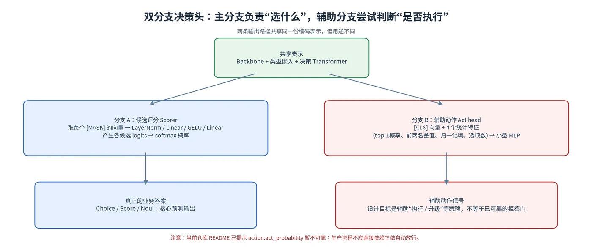
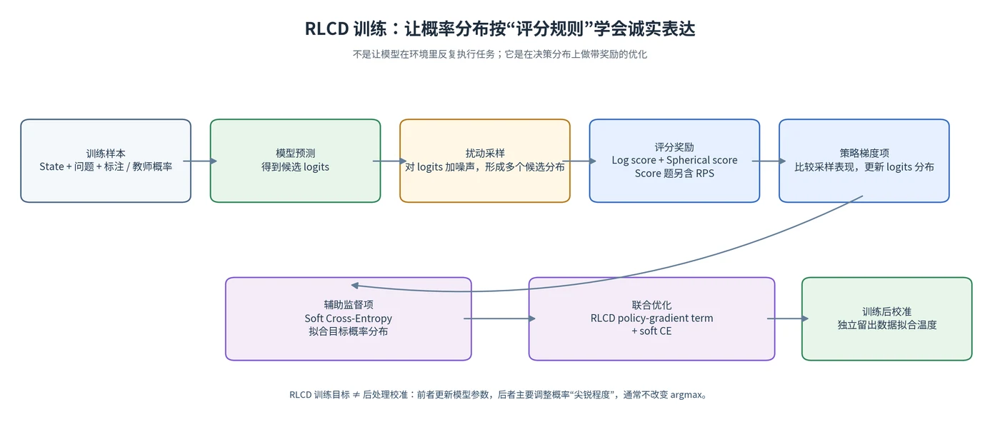
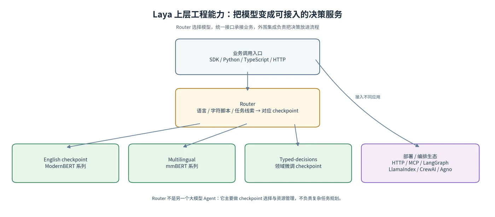
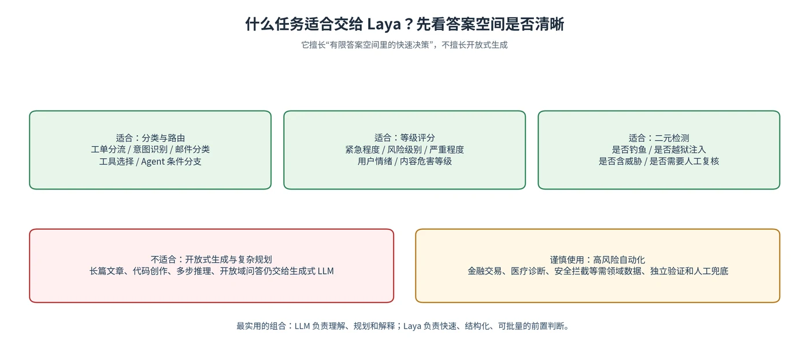

> 一篇面向开发者的 Laya 架构解读：讲清楚它的 BERT 主干究竟是什么、问题和选项如何进入模型、两个决策输出分支分别做什么、RLCD 怎样训练概率分布。
> 安装步骤和大段上手代码不作为重点。

> **一句话理解**：Laya 不想再生成一段很长的答案，而是让一个专门训练过的编码器直接回答"选哪个、打几分、是不是"。它更像 Agent 系统里的快速决策模块，而不是另一个通用聊天模型。

本文重点讲清楚 Laya 的模型结构和设计动机：它所使用的 BERT 主干究竟是什么、问题和选项如何进入模型、两个决策输出分支分别做什么、RLCD 怎样训练概率分布，以及 Router、HTTP 和 Agent 集成如何把它接入真实应用。

## 1. Laya 是什么：一个专门做结构化判断的模型

可以先把 Laya 想成一个"只做判断、不负责长篇表达"的模型。通用大语言模型接到问题后，通常要逐个生成 token，最后把答案组织成文字或 JSON；Laya 则把问题、候选答案和待判断内容一起送进编码器，直接给候选项打分，再返回结构化概率。

例如，客服系统收到一条消息："我上个月被重复扣款了，请尽快退款，否则我就取消会员。"系统可能同时要做三项判断：

- 应该交给哪个部门处理？（账单、技术、销售或其他）
- 这件事有多紧急？（低、中、高）
- 用户是否表达了取消会员的意图？（是 / 否）

对通用 LLM 来说，这些任务可以通过提示词完成；但它会走文本生成路径。Laya 把这些工作定义成固定类型的决策问题，让模型直接输出标签、等级或概率。项目将这种方式称为 non-autoregressive System 1 decision engine，即非自回归的快速决策引擎。

因此，Laya 的定位不是"取代 GPT"，而是承担那些答案空间已经定义清楚、调用频率高、希望结果稳定且容易被程序消费的判断任务。

## 2. 所谓"Laya 独有 BERT"：ModernBERT / mmBERT 主干

### 2.1 先纠正一个容易产生的误解

严格来说，Laya 并不是从零设计并预训练出一种全新的 BERT 架构。根据官方 README 和源码，原生 Laya 的文本决策模型建立在 ModernBERT 家族之上；多语言检查点使用 `mmBERT-base`。Laya 的特色不是发明了一个全新的 Transformer 编码器，而是把预训练编码器改造成了"读取问题、比较候选项、输出概率"的决策模型。

可以这样理解：BERT/ModernBERT 负责理解整段文本；Laya 的决策模块再把语义表示转换成每个候选项的可计算得分。主干提供语言表示能力，决策头负责把这些表示变成任务结果。

### 2.2 为什么选 BERT 式的双向编码器？

BERT 类模型的核心特点是双向上下文编码。一个 token 的表示不只依赖它左边的文字，也能利用右边的文字。对于分类、语义匹配和候选项判断，这种双向信息很有价值。

Laya 的输入不是单纯一段用户文本，而是"问题说明 + 候选项 + 用户状态"拼成的序列。模型需要同时理解：当前要判断什么、每个候选项是什么意思、用户文本提供了什么证据。双向编码可以让这些部分在同一次编码中互相提供上下文。

ModernBERT 还采用局部窗口注意力与全局注意力的组合。直观地说，不是每一层都让每个 token 无限制地和整段文本做完整注意力计算，而是交替使用局部和全局信息路径，在保留上下文理解能力的同时控制长序列计算成本。具体层配置以对应 checkpoint 的配置为准。

### 2.3 官方检查点并非只有一个

| 检查点方向 | 主干家族 | 参数规模（约） | 默认上下文 | 主要用途 |
| --- | --- | --- | --- | --- |
| English / 默认英文模型 | ModernBERT-large | 421M | 512 tokens | 英文场景，作为主要决策引擎 |
| Multilingual 多语言模型 | mmBERT-base | 322M | 1,024 tokens | 多语言与非拉丁文字场景；编码器支持扩展至 8,192 tokens |
| Typed-decisions 专用模型 | ModernBERT-large | 421M | 1,024 tokens | 针对公开 typed-decisions 工作流进一步微调 |

这里要注意：多语言能力不是靠"同一个英文模型突然学会所有语言"实现的，而是由不同 checkpoint 分工，再由 Router 做选择。官方文档显示，英文 checkpoint 在非拉丁文字场景可能出现明显退化；多语言 checkpoint 的定位就是补上这部分语言覆盖。

### 2.4 Laya 如何把自然语言问题变成模型能处理的输入？

Laya 不会只把用户文本直接塞给 BERT。它会先构造一个带有任务标记和候选标记的序列，形式可以概括为：

```
[CLS]  问题类型 + 指令  [SEP]  [MASK] 选项A  [MASK] 选项B  ...  [SEP]  State文本  [SEP]
```

每个候选项前面放一个 `[MASK]` 标记。编码器处理完整序列后，Laya 会取出这些标记位置上的隐藏向量，作为各候选项的表示。之后的评分层就可以分别判断"这个候选项与问题和状态是否匹配"。

![图 1｜问题、候选项和 State 被放入同一条输入序列；每个 [MASK] 对应一个候选项的读出位置。](/img/laya/figure-1.webp)

*图 1｜问题、候选项和 State 被放入同一条输入序列；每个 `[MASK]` 对应一个候选项的读出位置。*

这套设计是 Laya 很关键的一点：模型不用生成"我认为应该交给账单部门，因为……"这样的自然语言文本；它只需要计算每个候选项的分数。答案由分数和概率分布直接解码出来。

## 3. 一次前向传播如何完成决策

将整体流程拆开，大致可以看到以下几个连续步骤：

### 第一步：构造统一序列

把 State 序列化；把问题类型、指令和选项描述放在 State 前面；为每个选项插入一个 `[MASK]` 标记。

### 第二步：Backbone 编码

ModernBERT 或 mmBERT 对整条序列做双向编码，输出每个 token 的上下文表示。

### 第三步：注入问题类型

Laya 使用一个包含三种类型的 type embedding，把 choice、score、noul 的类型信息加到 token 表示上。这样同一套模型结构可以区分当前要解决的是哪一类问题。

### 第四步：共享决策层精炼表示

编码后的表示再经过一个较小的 Transformer Encoder 决策层。官方实现默认使用两层，让问题和候选项的表示进一步交互。

### 第五步：从候选标记位置取表示

根据 `marker_pos` 找出每个 `[MASK]` 位置对应的向量，交给评分器计算各选项的 logit。

### 第六步：得到概率并解码

对有效选项的 logits 做 softmax，得到候选项概率，再按问题类型转换为 choice、score 或 noul 输出。

关键点：同一个 State 如果需要回答多个问题，Laya 可以把这些问题组织成同一次请求，让它们共享编码前向过程。它不是每提出一个小问题就必须重新调用一次生成模型。这也是它在批量结构化判断场景中能够发挥效率优势的原因之一。

## 4. 双分支 Decision-Head：主决策分支与辅助动作分支

从源码看，Laya 的 DecisionModel 不只是一个简单的分类线性层。经过共享编码与两层决策 Transformer 后，它会走向两个不同的输出分支：一个负责给候选项打分，是主要业务答案的来源；另一个是 `act_head`，利用模型表示和若干统计特征，预测辅助动作信号。



*图 2｜共享编码后分成两条输出路径。主分支负责任务答案；辅助分支尝试提供动作层面的信号。*

### 4.1 分支 A：Scorer，真正决定"选哪个"

这是 Laya 最核心、也最应该重点理解的分支。模型会从共享决策层的输出中，取出每个候选项前 `[MASK]` 位置的向量。假设问题有三个选项，那么就会得到三个候选向量。

每个候选向量经过一个小型评分网络：LayerNorm → Linear → GELU → Linear，最后得到一个标量 logit。可以把 logit 理解为模型给这个候选项打的"未归一化分数"。所有候选项的 logits 放在一起，再经过 softmax，变成总和为 1 的概率分布。

| 环节 | 做什么 | 直观理解 |
| --- | --- | --- |
| Marker gather | 提取每个 `[MASK]` 位置上的隐藏向量 | 分别拿到每个候选项的表示 |
| Scorer MLP | 每个候选向量输出一个 logit | 为各候选项分别打分 |
| Mask + Softmax | 屏蔽无效填充位置，对真实选项归一化 | 形成候选概率分布 |
| Answer decoder | 按问题类型解释概率 | 输出类别、等级或 Yes 概率 |

这套主分支支持三种基本决策类型：

- **Choice**：多选一。比如"这条请求该由哪个部门处理？"返回最可能的标签，同时可以查看每个候选项的概率。
- **Score**：有序等级评分。比如"紧急程度是低、中还是高？"模型输出各等级的概率，最终分数可以理解为等级分布上的期望值。
- **Noul**：二元真假概率。比如"用户是否明确要求退款？"模型在 false / true 两个语义选项之间分配概率，返回 `P(true)`。

因此，所谓"一个模型回答很多类型的问题"，并不是它可以无边界地回答任何自然语言问题，而是它把常见决策任务统一抽象成三种可计算的概率分布。

### 4.2 分支 B：Act head，辅助判断"是否采取动作"

第二个分支叫 `act_head`。它不是再做一遍 Choice/Score/Noul，而是尝试根据模型整体表示和主分支的分布特征，输出一个动作层面的预测。源码中，它会读取 `[CLS]` 位置的整体表示，并拼接四个统计量：

| 拼接特征 | 含义 | 它为什么有用 |
| --- | --- | --- |
| Top-1 probability | 当前最可能候选项的概率 | 粗略观察模型有多偏向第一名 |
| Top-1 minus Top-2 | 第一名与第二名的概率差 | 判断最优候选是否明显领先 |
| Normalized entropy | 归一化概率熵 | 观察整体分布是否分散或犹豫 |
| Option count / 255 | 当前候选项数量的缩放值 | 让动作分支知道选择空间有多大 |

这些特征与 `[CLS]` 的整体语义表示拼接后，进入一个小型 MLP（源码中为 Linear → GELU → Linear），得到动作 logits。它设计上的意图，是学习类似"当前判断是否足以执行，还是需要升级处理"的辅助信号。

但必须强调：有一个辅助输出头，并不代表它已经是可靠的自动决策闸门。当前官方 README 的 Known limitations 明确指出，公开检查点的 `action.act_probability` 暂时没有可用信号，几乎对多数输入都给出 1.0，且在一组标注样本上的原始 logits 与正确性呈反向关系。因此，不能把这个分支描述成已经成熟的自动审批、拒答或人工升级机制。实际落地时，应基于主分支经过验证的概率、独立校准结果和业务规则设计人工兜底。

### 4.3 容易混淆的三个"Head"

读源码时容易看到多个 head 字样，最好把它们区分开：

| 名称 | 在架构中的角色 | 是否直接输出最终候选答案 |
| --- | --- | --- |
| `type_emb` | 告诉共享模型当前问题属于 choice / score / noul 哪一类 | 否 |
| `self.head` | 编码器之后的轻量 Transformer 精炼层 | 否 |
| `scorer` | 读取候选标记位置，为每个候选输出 logit | 是，主要答案分支 |
| `act_head` | 利用 `[CLS]` 与统计特征输出辅助动作信号 | 否，属于辅助分支 |

## 5. RLCD：用奖励优化概率分布，再单独做校准

### 5.1 RLCD 到底是什么？

RLCD 是 Laya 文档所称的 Reinforcement Learning against strictly proper scoring rules。可以译作"基于严格适当评分规则的强化学习式训练"。它的重点不是让模型像游戏 Agent 一样在环境里连续试错，而是让模型输出的概率分布接受一套有数学性质的评分规则评价。

为什么要关心概率，而不只关心预测标签？想象两条模型输出：第一条认为"账单部门 51%，技术部门 49%"；第二条认为"账单部门 99%，技术部门 1%"。如果正确答案确实是账单，二者虽然都猜对，但第二条表达了更高的确定性。模型必须学会的不只是猜对，还要让概率和真实的不确定程度尽量一致。

严格适当评分规则的直观意思是：当真实标签分布已知时，模型如实报告自己的概率分布，能够获得最高的期望得分。这样训练不仅追求分类结果，也把概率质量放进了优化目标。

总奖励可概括为：

$$
R = \text{LogScore} + w_{\text{sph}} \cdot \text{SphericalScore} - w_{\text{rps}} \cdot \text{RPS}
$$

其中，RPS 只用于有序的 Score 题型；Choice 和 Noul 不计算这项有序距离惩罚。训练配置里的 $w_{\text{sph}}$ 默认值为 0.75，$w_{\text{rps}}$ 默认值为 1.0。

### 5.2 一轮 RLCD 训练大概怎么进行？



*图 3｜RLCD 主流程：对模型 logits 采样、按适当评分规则计算奖励，再与软标签交叉熵一起优化。*

#### 第一步：准备训练目标

训练样本由 State、问题定义和目标答案组成。目标可以是硬标签，也可以是教师模型给出的概率分布。概率目标更细致地保留了教师对多个候选项的相对判断。

#### 第二步：模型产生候选概率

模型先输出各候选项的 logits。训练过程不是只取一次 softmax 的结果，而是围绕 logits 加入零均值噪声，采样出多个略有差异的概率分布。

#### 第三步：给每个采样分布打分

采样结果根据目标概率分布计算 proper reward。公开实现包含 log score 和 spherical score；对于 Score 这类有序等级问题，还会考虑 ranked probability score（RPS），因为把真实等级预测成相邻等级和预测成很远的等级，错误程度应该有所区别。

#### 第四步：形成相对优势并更新

同一条样本的多个扰动分布会比较各自获得的奖励，形成归一化优势，再通过类似策略梯度的项更新 logits 对应的模型参数。直觉上，表现更好的概率分布会得到更大的优化推动。

#### 第五步：叠加 Soft Cross-Entropy

RLCD 并不是只靠奖励项训练。官方实现还把软目标交叉熵加进损失，让模型同时直接拟合目标分布。

官方训练配置的默认示例是每个项目采样 4 份 noisy logits，探索噪声由 0.4 逐步衰减到 0.1；proper reward 中 spherical score 权重默认为 0.75，Score 问题额外使用 RPS。具体数值是当前训练脚本的默认配置，不意味着所有训练实验都必须使用这一组超参数。

### 5.3 RLCD 和"概率校准"不是一回事

这点非常重要：RLCD 是训练阶段的目标函数，会更新编码器和决策头参数；温度校准则通常发生在训练之后，主要调整模型输出分布的尖锐程度。温度缩放一般不会改变概率最大的那个类别（argmax），但会改变"模型看起来有多自信"。

例如，模型对某个类别给出 0.99 的概率，但在验证集上发现所有 0.99 置信度的样本实际正确率只有 0.75，那么这套概率就过度自信。温度校准试图根据留出的校准数据，修正这种偏差。Laya 的微调流程会在训练前留出一部分样本，再拟合不同问题类型的温度。

不要把"使用了 RLCD"理解为"所有输出概率从此天然可信"。官方文档明确提醒，发布的基础检查点可能过度自信；阈值必须结合目标领域的留出数据拟合和验证。校准效果还取决于样本规模、样本代表性和线上数据分布是否发生变化。

官方 README 给出了一个校准示例：在留出数据上，按问题类型拟合温度后，英文检查点的平均 ECE 从 0.466 降到 0.081；多语言检查点从 0.314 降到 0.106。这里的 ECE 是期望校准误差，越低通常表示置信度与实际正确率越贴近。注意这组结果是项目报告的特定校准实验，不保证在你的数据上获得相同改善；多语言检查点发布时也没有预先拟合好的温度。

### 5.4 目前能看到的效果证据应该怎样读？

官方 README 报告的 typed-decisions 基准包含 400 个案例、2,000 次决策、四种工作流。基础英文 checkpoint 的准确率为 0.362，多语言 checkpoint 为 0.352；使用该基准训练集微调后的 laya-typed-decisions checkpoint 达到 0.766。该基准的多数类基线为 0.461，随机基线为 0.318。也就是说，基础模型在这项任务上并没有达到可直接依赖的效果，0.766 主要来自针对任务数据的微调。

这组数字只代表仓库所报告的特定基准、训练配方和检查点，不能直接推断成"任何公司数据上都能达到 76.6%"，更不能代替在目标业务上的独立测试。评估时至少应同时看准确率、概率校准误差（例如 ECE / Brier）、不同语言与工作流切片，以及错误成本。

## 6. Router：为什么不是一个模型处理所有请求

Laya 的 Router 是模型选择和资源管理层。它的主要职责不是替用户规划任务，而是在真正运行模型前，判断当前请求更适合哪个 checkpoint。



*图 4｜Router 根据语言、文字脚本或显式任务信息选择合适的模型，再调用对应 Agent。*

### 6.1 路由会看什么？

- **语言和文字脚本**：例如明显的非拉丁文字请求不应误交给仅适合英文的 checkpoint。
- **显式提示**：调用者可以指定 `model`、`task` 或 `lang`；显式指定通常优先于自动判断。
- **任务线索**：在启用相应检测配置时，可以依据已知 workflow / typed-decision 任务将请求送到专门检查点。
- **默认路径**：当文本过短、语言证据不足时，Router 使用配置的默认模型，而不是假装自己识别出了准确语言。

这里最重要的是"模型之间有分工"。官方 README 的对比实验显示，英文 checkpoint 在英语数据上表现更好，多语言 checkpoint 在其他语言上的覆盖更广；Router 组合后可以在不同语言之间选择相对合适的模型。仓库还指出，英文 checkpoint 在非拉丁脚本上可能严重退化，不能仅靠置信度阈值弥补错误路由。当前 Router 会根据文字脚本和语言线索选择 checkpoint；很短的文本可能缺乏足够的语言证据，会落到默认模型，因此生产系统应按自己的流量分布配置默认模型并监控路由结果。

### 6.2 Router 还有模型加载与批处理管理

模型权重比较大，因此 Router 不只是 if/else。它支持按需加载 checkpoint，避免一开始就把全部模型塞进内存；也可以预加载模型，以降低服务运行期间首次切换模型的冷启动成本。默认还会限制同时驻留的 checkpoint 数量，并按最近最少使用的方式回收不常用模型。

批处理时，Router 可以先为一批请求决定各自使用哪个 checkpoint，再按模型和问题结构分组执行预测，最后把结果还原到输入顺序。对于批量工单、评论审核或日志分类，这比每条请求单独触发完整推理更适合做吞吐优化。

## 7. HTTP 与 Agent 生态：从 SDK 变成服务能力

一个模型只有 Python 函数还不够。企业系统可能由 Java、Go、Node.js 或其他语言编写，也可能已经使用 LangGraph 编排多个 Agent。Laya 在模型之外提供了若干工程接口，让它可以以服务或工具的方式进入现有系统。

### 7.1 HTTP 服务：把本地模型包装成统一接口

官方提供 `laya.serve` HTTP 服务，暴露与 Router 相结合的推理入口。核心请求协议采用 `POST /v1/systemone`；批量请求则可以通过 batch 接口一次提交多个 State。官方说明其响应结构与 Jev 的对应协议兼容，包括 choice、score、noul 结果字段以及 token 使用信息。

这意味着已有客户端不一定要在每个业务进程里都加载 PyTorch 和模型权重。可以把 Laya 部署在一台专门的推理机器上，其他服务通过 HTTP 调用它。部署时还需要自行配置网络访问控制、API Key、超时、批大小、日志和模型预加载策略。

### 7.2 Hooks：把治理逻辑放在模型前后

Hooks 可以理解成模型调用过程中的"插槽"。业务团队可以在预测开始前或结束后执行自己的逻辑，例如：记录审计日志、脱敏个人信息、从缓存返回结果、采集耗时指标、覆盖模型路由、检查输出是否需要进一步处理。这样不用为了加入业务逻辑而直接修改模型核心代码。

### 7.3 Agent 框架集成：让 Laya 成为流程中的一个决策节点

Laya 提供了与 LangChain / LangGraph 的集成组件，例如决策节点、路由器和 Guardrail。放在 LangGraph 中时，Laya 可以先做快速分类，再根据结果走不同条件边；也可以在进入昂贵的 LLM 或工具执行前，先做 Prompt 安全检测。

官方文档还列出 LlamaIndex、CrewAI、Agno 等集成入口，以及 MCP 服务方式。这里的分工是：上层框架负责 Agent 之间的协作、工具执行和多步计划；Laya 负责在需要的节点上提供快速、结构化的判断结果。

## 8. 适合使用 Laya 的场景



*图 5｜判断是否适合 Laya，先问：答案是不是可以归纳为有限类别、等级或真假概率？*

### 8.1 意图识别与请求分流

这是最自然的应用。比如用户请求可以分成账单问题、技术问题、账户问题、销售咨询和其他请求。模型只需要比较预定义的类别，再把请求交给不同业务队列或不同 Agent。

### 8.2 工单优先级与风险等级评估

当问题本身有明确的等级标准时，可以用 Score。比如把紧急程度划分为普通、较急、阻塞业务；把内容风险划分为低、中、高。前提是等级定义要清晰，训练和评估样本要覆盖真实业务中的边界情况。

### 8.3 二元风险检测与安全前置判断

是否包含钓鱼意图、是否出现辱骂或威胁、是否存在越狱提示、是否明确提出退款等，都可以抽象成 Noul 判断。对于安全策略，应把 Laya 当作前置检测组件，而不是唯一的安全屏障。高风险动作仍应结合确定性规则、白名单/黑名单和人工复核。

### 8.4 Agent 的快速条件路由

在多 Agent 系统里，Laya 可以先判断任务类型、风险标签或需要调用的工具类别，再让 LangGraph 等编排层选择下一节点。尤其适合大量请求都需要做同样几项简单判断，但后续处理路径不同的系统。

### 8.5 大批量文本筛选

当系统需要对大量评论、工单、邮件或日志做多项相同判断时，Laya 的 batch 能力可以减少逐条调用带来的固定开销。它适合作为离线数据筛查、在线请求分类和实时预警流水线中的一个判定模块。

## 9. Laya 的优势、局限与落地建议

### 9.1 优势：它为什么值得关注？

#### 一、绕开逐 token 生成

主任务是候选项打分而不是生成一段回答，因此没有长答案生成和 JSON 文本解析这类额外步骤。

#### 二、短文本决策延迟较低

仓库公布的 Tesla T4 基准中，单问题调用的英文 checkpoint 约 39.5 ms，多语言 checkpoint 约 32.8 ms；批处理吞吐报告为每秒约 103–332 个问题。这些是特定硬件、输入和测试设置下的测量值，不是所有设备上的延迟承诺。

#### 三、一次编码可以处理多个问题

问题类型和候选项被统一组织进模型输入，多个相关判断可以在共享编码结果上完成。

#### 四、输出结构适合程序消费

choice、score、noul 都有明确的数据形态，方便接入业务路由、统计报表和规则系统。

#### 五、模型可以在本地部署

不必把每次判断都发到第三方托管大模型服务；对于有数据边界要求的场景，本地推理是重要优势。

#### 六、语言路由与工程接口比较完整

Router、批处理、Hooks、HTTP、MCP 和多种 Agent 框架集成，让它不只是一个模型权重文件。

#### 七、可以围绕业务数据做专项微调

如果业务标签和决策类型清晰，可以通过数据适配让模型更贴近目标工作流。

### 9.2 局限：不要把它当作通用 LLM

- **任务边界比较明确**：它主要支持 Choice、Score、Noul，不负责开放式回答、长篇解释、代码生成或复杂计划。
- **零样本领域能力并不保证**：官方报告中的 typed-decisions 基准显示，基础检查点在该基准上接近随机基线；需要用真实领域数据验证或微调。
- **概率不自动等于可信**：基础检查点存在过度自信现象。未经留出集校准和阈值验证，不要仅凭 confidence 就自动执行高影响动作。
- **多语言不是完全均匀**：不同 checkpoint 的语言能力有明显差异，路由错误可能造成高置信度误判。仓库的 51 语言评测中，多语言 checkpoint 有 48 个语言达到项目定义的可用门槛；这不等于 100 多种语言都达到相同水平。
- **高基数选项有输入预算限制**：公开基准中，77 个候选标签的 Banking77 任务在默认预算下准确率明显下降。原因是问题与候选项共享有限的 head token 预算，选项太多时每个标签获得的 token 太少，语义容易变得不可区分。大类别空间要提高预算、做 shortlist，或拆成粗到细的多阶段选择。
- **决策定义本身很关键**：候选项含义重复、描述模糊、标签不平衡、否定表达或大量选项都会影响结果，需要专门构造测试集。当前 README 还特别提醒，Choice 标签不宜直接使用 yes/no/true/false 等容易干扰语义的词；英文检查点的 Noul 若不提供有区分度的 true / false criteria，可能过度跟随默认选项文字，出现对不同输入都给出 No 的问题。
- **Act head 目前有已知问题**：官方文档提示其公开 `action.act_probability` 信号不可用，不应把它宣传为成熟的自动拒答机制。README 建议暂时基于经过验证的 confidence 做门槛策略，并在自己的留出数据上重新拟合和验证阈值。

### 9.3 比较稳妥的落地方法

- 先挑一个答案空间足够清楚、错误成本可控的任务做试点，例如工单分类。
- 把标签和每个候选项的业务含义写清楚，避免只用模糊的短标签。
- 建立独立训练集、校准集和测试集；不要拿训练数据上的置信度直接决定线上阈值。
- 分语言、分业务类型、分选项数量看效果，尤其要测试否定表达、边界案例和分布外输入。
- 让 Laya 做前置判断或候选分流；低置信度、高风险和规则冲突的样本进入 LLM 复核或人工处理。
- 持续监控线上准确率、校准误差、覆盖率和人工升级比例，数据分布变化后重新评估。

## 10. 总结：把 Laya 放在 Agent 的哪个位置

如果把一个完整 Agent 系统比作一家公司，通用 LLM 更像负责理解需求、制定方案、组织语言的"综合分析人员"；Laya 则更像一个反应快、接口明确的"分流与判断模块"。它不承担所有事情，但可以把高频、重复、答案范围明确的判断从昂贵的生成式模型路径中拆出来。

从架构上看，Laya 的核心价值来自几层设计的配合：ModernBERT / mmBERT 提供双向文本表示；输入序列中的 `[MASK]` 标记把每个候选项变成可读取的位置；共享决策 Transformer 精炼表示；Scorer 分支把候选项转为概率；RLCD 训练目标让模型学习更合理的概率分布；温度校准再在留出数据上修正置信度；Router 和外围服务则负责把正确的检查点送到正确的业务请求上。

它最适合成为 Agent 系统的"快速决策层"，例如先做意图分类、风险筛查、工具类别选择和工作流分流，再把复杂推理交给上层 Agent。对于开放式问答、多步规划和需要充分解释的任务，仍应交给生成式大模型。

一句话总结：Laya 的创新重点不是让 BERT 变成另一个 ChatGPT，而是让编码器不再只做传统分类，而能直接围绕明确的问题和候选项输出结构化决策。

## 参考资料与版本说明

本文以 2026 年 11 月 16 日可访问的项目主仓库 README、官方文档和源代码为依据。由于 Laya 的主分支持续更新，具体 API、性能和检查点配置请以使用时版本为准。

- **GitHub 项目主页与 README**：<https://github.com/NandhaKishorM/laya>
- **官方文档主页**：<https://nandhakishorm.github.io/laya/>
- **模型结构与输入序列源码（common.py）**：<https://raw.githubusercontent.com/NandhaKishorM/laya/main/laya/common.py>
- **微调与 RLCD 训练源码（train.py）**：<https://raw.githubusercontent.com/NandhaKishorM/laya/main/laya/train.py>
- **官方 Fine-tuning 文档**：<https://nandhakishorm.github.io/laya/finetune/>
- **README 中的 Router、HTTP、Agent 集成与局限说明**：<https://github.com/NandhaKishorM/laya/blob/main/README.md>

**特别说明**：当前仓库还扩展了可选的 Vega / vegaml 推理路径。它使用另一套 reader 模型与能力边界，不应与本文重点解读的原生 ModernBERT / mmBERT 决策模型混为一谈。本文讨论"Laya 的 BERT 主干和双分支决策结构"时，默认指不启用 vegaml 的原生编码器路径。

## 核心术语速查

| 术语 | 通俗解释 |
| --- | --- |
| Backbone（主干编码器） | 负责读取整段输入并生成上下文表示的预训练 Transformer Encoder；Laya 原生路径使用 ModernBERT 或 mmBERT。 |
| `[MASK]` Marker（候选标记位） | 放在每个候选答案前的可读取位置。模型编码整段序列后，从这些位置提取候选项表示。 |
| Decision Head（决策头） | 位于 Backbone 之上的任务专用网络，把上下文表示转成候选项分数和辅助动作信号。 |
| Option Scorer（候选评分器） | 主决策分支，为每个候选项计算 Logit，再通过 Softmax 得到概率分布。 |
| Action Head（辅助动作头） | 利用整体表示和概率统计特征产生辅助动作概率；当前公开检查点该信号不可靠，不应直接作为生产门禁。 |
| RLCD | 通过严格适当评分规则评价预测概率，并用策略梯度优化模型输出分布的训练范式。 |
| Calibration（概率校准） | 在独立留出数据上调整预测概率，使模型报出的置信度更接近实际正确率。 |
| ECE（Expected Calibration Error） | 衡量置信度与实际准确率偏差的常见指标，数值越低通常表示校准越好。 |
| Router（路由器） | 根据语言、任务提示或显式配置选择合适的模型检查点，并管理加载、复用和批量请求。 |
